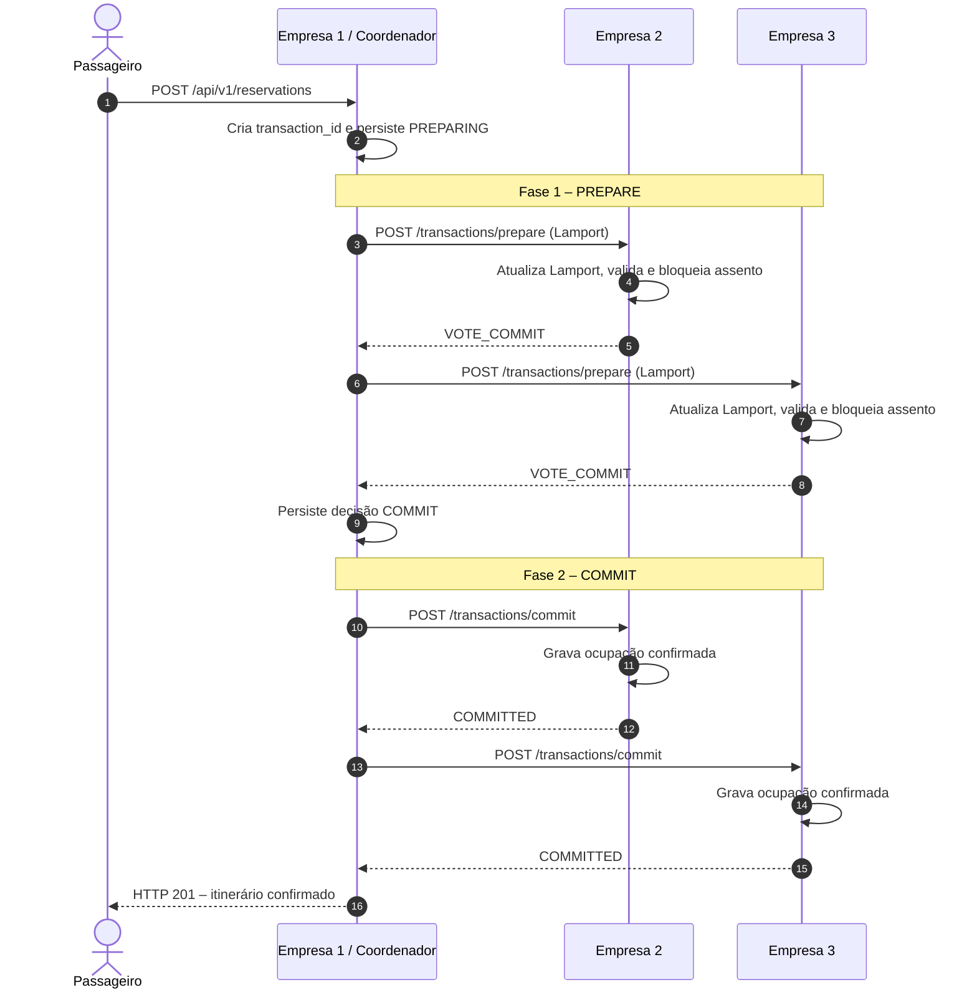
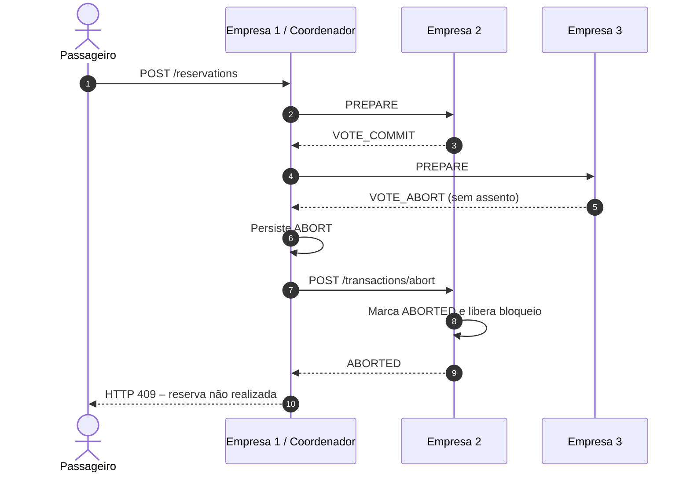
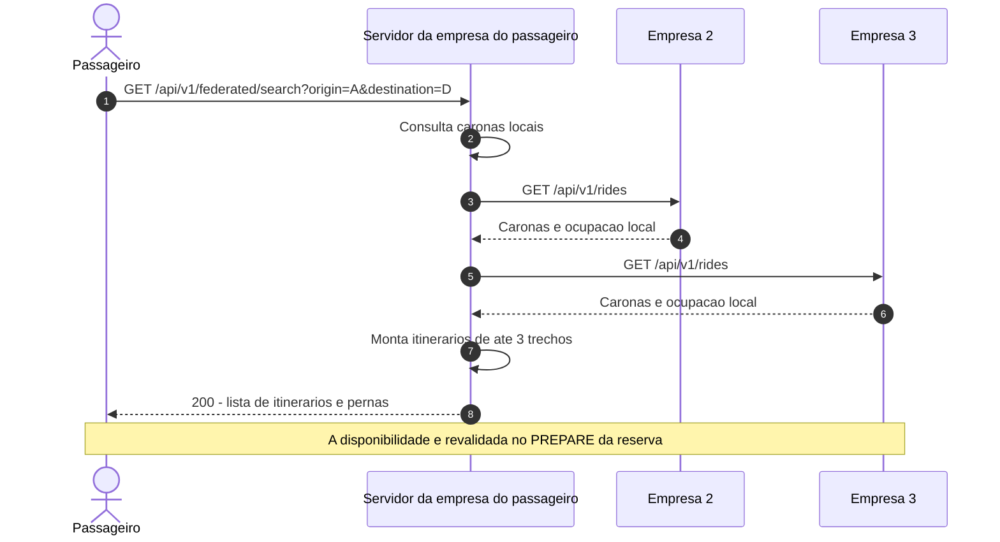

# Diagramas de sequência – VaiJunto

## Reserva confirmada



## Falha durante PREPARE



## Timeout e recuperação

```mermaid
sequenceDiagram
    autonumber
    participant S1 as Coordenador
    participant S2 as Participante
    S1->>S2: PREPARE
    S2->>S2: Persiste PREPARED com prazo
    S2-->>S1: VOTE_COMMIT
    S1--xS2: COMMIT/ABORT sofre timeout ou conexão cai
    Note over S2: Prazo expirou; não libera por conta própria
    S2->>S1: GET /transactions/{id}
    alt Coordenador decidiu COMMIT
        S1-->>S2: COMMIT
        S2->>S2: Efetiva reserva
    else Coordenador decidiu ABORT
        S1-->>S2: ABORT
        S2->>S2: Libera bloqueio
    else Coordenador indisponível
        S1--xS2: Sem resposta
        Note over S2: Mantém PREPARED até recuperar decisão
    end
```

## Busca federada antes da reserva


